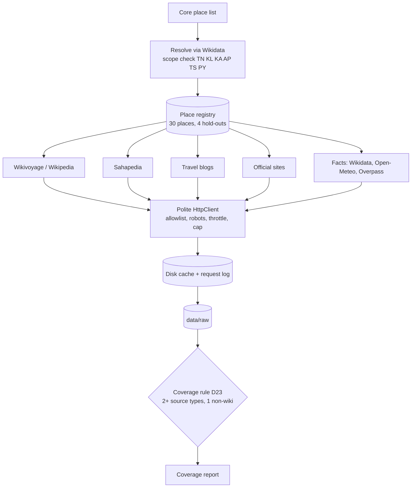
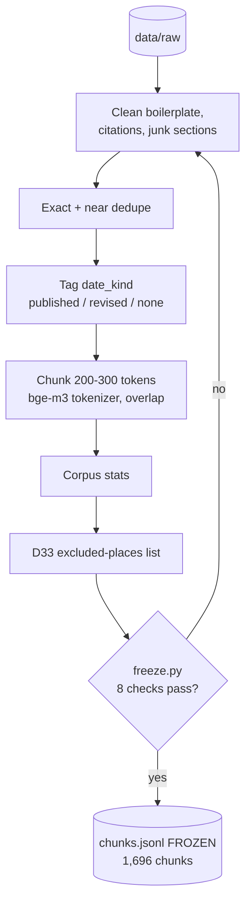
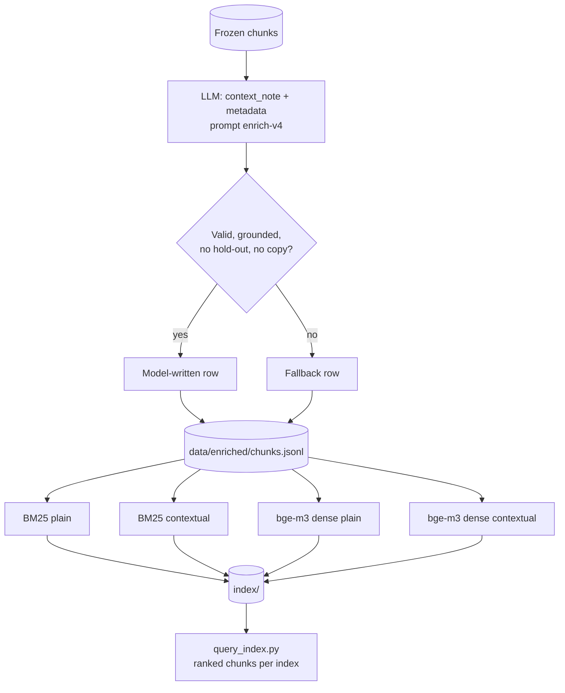
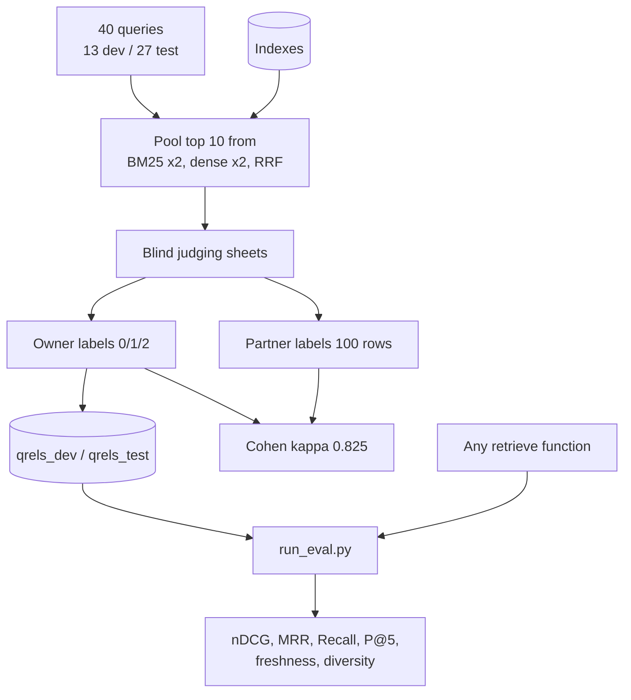
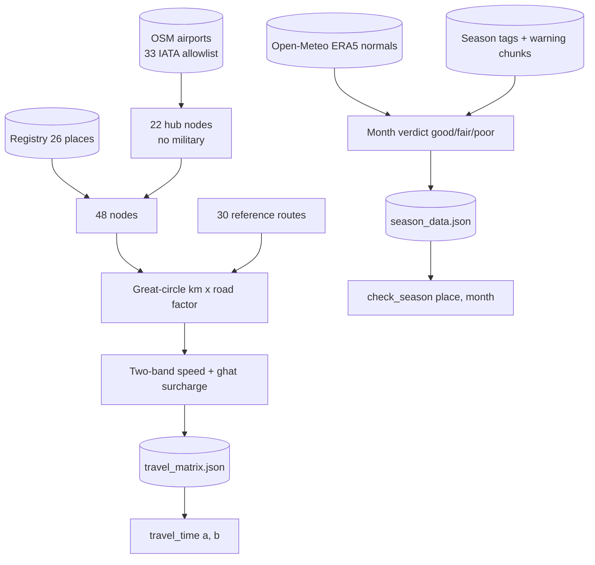
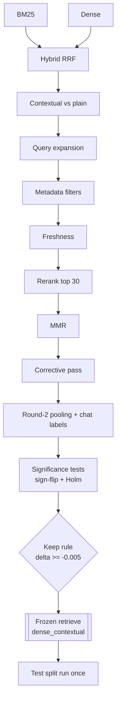
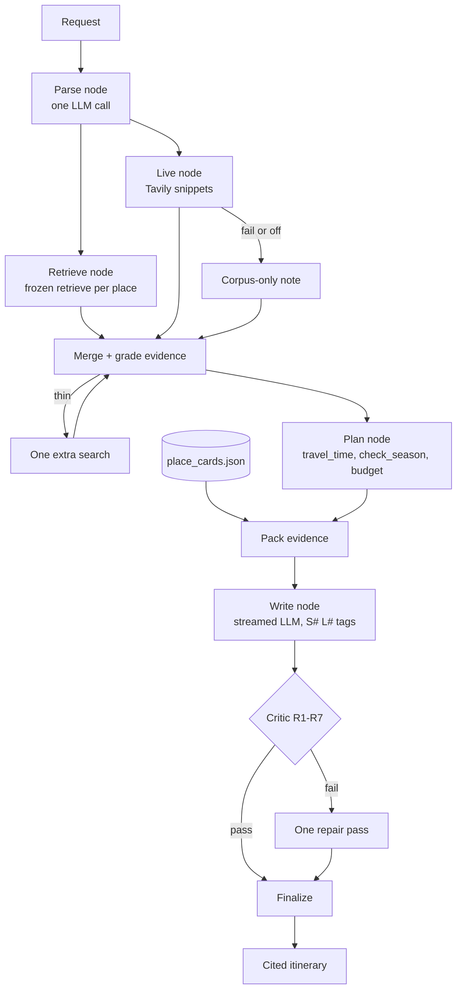

# Phase Flowcharts

Each chart has a **Code map** table under it with clickable links to the code (Ctrl+click in VS Code). The chart nodes also carry `click` links where the viewer allows them (some viewers, including GitHub, disable them; the tables always work). Line numbers are as of the current branch and may drift.

## Phase 1: Data collection and place registry

| Node | Code |
|---|---|
| Resolve via Wikidata, scope check | [resolve_place](../src/places/places.py#L331), [WikidataClient](../src/places/places.py#L223) |
| Place registry | [Registry](../src/places/places.py#L38) |
| Wikivoyage / Wikipedia | [WikiCollector](../src/collect/sources.py#L53) |
| Travel blogs, official sites | [WebCollector](../src/collect/sources.py#L212), [allowlist config loader](../src/collect/sources.py#L125) |
| Reddit (access pending) | [RedditCollector](../src/collect/sources.py#L368) |
| Facts (Wikidata, Open-Meteo, Overpass) | [facts.py](../src/facts/facts.py) |
| Polite HttpClient, allowlist, request log | [HttpClient](../src/common/http.py#L306), [Allowlist](../src/common/http.py#L117), [RequestLog](../src/common/http.py#L73) |
| Disk cache | [DiskCache](../src/common/cache.py#L61) |
| Coverage rule D23 | [passes_rule](../src/collect/run.py#L236), [place_coverage](../src/collect/run.py#L240) |
| Entry points | [collect.py](../scripts/collect.py#L539), [coverage_report.py](../scripts/coverage_report.py#L26), [build_collectors](../src/collect/run.py#L504) |

## Phase 2: Cleaning and chunking

| Node | Code |
|---|---|
| Clean boilerplate | [clean_record](../src/process/process.py#L199), [learn_boilerplate](../src/process/process.py#L240) |
| Exact + near dedupe | [dedupe_records](../src/process/process.py#L466), [near_dups](../src/process/process.py#L494) |
| Drop hold-out text | [record_holdout](../src/process/process.py#L406), [HoldoutFilter](../src/facts/facts.py#L133) |
| Tag date_kind | [date_fields](../src/process/process.py#L395) |
| Chunk 200-300 tokens | [chunk_text](../src/process/process.py#L347), [load_counter](../src/process/process.py#L40) |
| Per-place pipeline | [process_place](../src/process/process.py#L427) |
| Corpus checks | [check_corpus](../src/process/process.py#L580) |
| Freeze (8 checks) | [preconditions](../scripts/freeze.py#L86), [run](../scripts/freeze.py#L160), [d33_table](../scripts/freeze.py#L131) |
| Driver | [scripts/process.py](../scripts/process.py#L241) |

## Phase 3: Enrichment and indexing

| Node | Code |
|---|---|
| LLM enrichment (prompt, validators, fallbacks) | [enrich_chunk](../src/process/enrich.py#L373), driver [scripts/enrich.py](../scripts/enrich.py#L257) |
| LLM client (hosted API, rate limiter) | [OpenAICompatClient](../src/common/llm.py#L710), [RateLimiter](../src/common/llm.py#L528) |
| Enriched file matches frozen | [check_enriched_matches_frozen](../src/process/process.py#L558) |
| BM25 indexes | [build_bm25](../src/retrieval/build_index.py#L85), [bm25_text](../src/retrieval/build_index.py#L60) |
| Dense indexes | [build_dense](../src/retrieval/build_index.py#L141), [dense_text](../src/retrieval/build_index.py#L64), [load_encoder](../src/retrieval/build_index.py#L113) |
| Manifest and verify | [write_manifest](../src/retrieval/build_index.py#L217), [verify_index](../src/retrieval/build_index.py#L234) |
| Index build script | [scripts/build_index.py](../scripts/build_index.py#L65) |
| Query one index | [scripts/query_index.py](../scripts/query_index.py#L42), [Index](../src/retrieval/search.py#L45) |

## Phase 4: Test collection and evaluation harness

| Node | Code |
|---|---|
| Queries | [eval/queries.json](../eval/queries.json), checker [check_queries.py](../scripts/check_queries.py#L41) |
| Pooling | [build_pool](../eval/pooling.py#L37), [scripts/pool.py](../scripts/pool.py#L58) |
| Blind sheets, label import | [sheet_rows](../eval/pooling.py#L115), [parse_label](../eval/pooling.py#L150), [verify_unchanged](../eval/pooling.py#L157), [import_labels.py](../scripts/import_labels.py#L79) |
| Qrels loaders (test split guarded) | [load_qrels](../eval/qrels.py#L71), [load_qrels_merged](../eval/qrels.py#L94) |
| Cohen's kappa | [kappa](../scripts/kappa.py#L52), [compute](../scripts/kappa.py#L128) |
| Harness | [eval/run_eval.py](../eval/run_eval.py) |
| Metrics | [ndcg_at_k](../eval/metrics.py#L47), [reciprocal_rank](../eval/metrics.py#L59), [recall_at_k](../eval/metrics.py#L76), [freshness_share](../eval/metrics.py#L101), [diversity](../eval/metrics.py#L116) |

## Phase 5: Routing reference data

| Node | Code |
|---|---|
| Hubs and airport allowlist | [airports_allowlist.json](../config/airports_allowlist.json), [routing_params.json](../config/routing_params.json) |
| Calibration routes | [calibration_routes.json](../config/calibration_routes.json), [cmd_calibrate](../scripts/build_routing.py#L86) |
| Build matrix | [build_matrix_doc](../scripts/build_routing.py#L95), [cmd_matrix](../scripts/build_routing.py#L119) |
| Build season data | [build_season_doc](../scripts/build_routing.py#L109), [cmd_season](../scripts/build_routing.py#L128) |
| Sanity table | [cmd_sanity](../scripts/build_routing.py#L134) |
| Outputs | [travel_matrix.json](../index/travel_matrix.json), [season_data.json](../index/season_data.json) |
| Lookups | [travel_time](../src/tools/travel_time.py#L62), [check_season](../src/tools/check_season.py#L91) |

## Phase 6: Retrieval engine and ablations

| Node | Code |
|---|---|
| BM25 / dense search | [bm25_scores](../src/retrieval/build_index.py#L102), [Index](../src/retrieval/search.py#L45), [hybrid_ids](../src/retrieval/hybrid.py#L19) |
| Hybrid RRF | [rrf](../src/retrieval/fusion.py#L14) |
| Query expansion | [parse_query](../src/retrieval/query_understanding.py#L286), [validate](../src/retrieval/query_understanding.py#L251), [expanded_ids](../src/retrieval/hybrid.py#L26) |
| Metadata filters | [Filters](../src/retrieval/filters.py#L40), [partition](../src/retrieval/filters.py#L130) |
| Freshness | [freshness_factor](../src/retrieval/freshness.py#L29), [rerank](../src/retrieval/freshness.py#L49) |
| Cross-encoder rerank | [apply_scores](../src/retrieval/rerank.py#L31), [CrossEncoderScorer](../src/retrieval/rerank.py#L93) |
| MMR | [mmr_order](../src/retrieval/mmr.py#L50), [apply_mmr](../src/retrieval/mmr.py#L69), [select_lambda](../src/retrieval/mmr.py#L82) |
| Corrective pass (CRAG-style) | [fired](../src/retrieval/grader.py#L74), [contradiction](../src/retrieval/grader.py#L60), [generate_rewrite](../src/retrieval/grader.py#L125) |
| Ablation driver | [eval/ablation.py](../eval/ablation.py#L151), [variants.py](../eval/variants.py) |
| Round-2 pooling | [eval/pooling2.py](../eval/pooling2.py), [scripts/pool2.py](../scripts/pool2.py#L132) |
| Significance | [randomization_test](../eval/significance.py#L40), [bootstrap_ci](../eval/significance.py#L72), [holm](../eval/significance.py#L88) |
| Frozen retrieve() | [retrieve](../src/retrieval/retrieve.py#L269), [retrieve_with_trace](../src/retrieval/retrieve.py#L258), [frozen_config.json](../eval/frozen_config.json) |
| Equivalence check, test run | [verify_retrieve.py](../scripts/verify_retrieve.py#L90), [test_run.py](../scripts/test_run.py#L141) |

## Phase 7: Place cards and agent pipeline

| Node | Code |
|---|---|
| Wiring (LangGraph and sequential fallback) | [run_graph](../src/agents/graph.py#L105), [run_local](../src/agents/graph.py#L63), CLI [run_pipeline.py](../scripts/run_pipeline.py#L77) |
| Parse node | [parse_node](../src/agents/nodes.py#L111), [parse_query](../src/retrieval/query_understanding.py#L286) |
| Retrieve node | [retrieve_node](../src/agents/nodes.py#L145), [retrieve](../src/retrieval/retrieve.py#L269) |
| Live node | [live_node](../src/agents/nodes.py#L198), [live_retrieve](../src/live/search.py#L218), [live config and terms gate](../src/live/config.py), [closed-vocabulary queries](../src/live/queries.py) |
| Merge + grade, extra search | [merge_grade_node](../src/agents/nodes.py#L212), [scope.py](../src/agents/scope.py) |
| Plan node | [plan_node](../src/agents/nodes.py#L245), [plan_trip](../src/agents/planner.py#L164), [budget estimate](../src/agents/budget.py#L12), [travel_time](../src/tools/travel_time.py#L62), [check_season](../src/tools/check_season.py#L91) |
| Place cards | [get_place_card](../src/tools/place_cards.py#L240), builder [build_place_cards.py](../scripts/build_place_cards.py#L55) |
| Pack evidence | [pack](../src/agents/evidence.py#L353) |
| Write node (streamed) | [write_node](../src/agents/nodes.py#L265), [write](../src/agents/writer.py#L138), [OpenAICompatClient](../src/common/llm.py#L710) |
| Critic R1-R7, repair | [critic_node](../src/agents/nodes.py#L289), [check](../src/agents/critic.py#L139), [deterministic_fix](../src/agents/critic.py#L261) |
| Finalize | [finalize_node](../src/agents/nodes.py#L322) |
| State and request parsing | [state.py](../src/agents/state.py), [deps.py](../src/agents/deps.py) |
| App (Phase 8) | [streamlit_app.py](../app/streamlit_app.py), [state.py](../app/state.py), [query_cache.py](../app/query_cache.py) |
