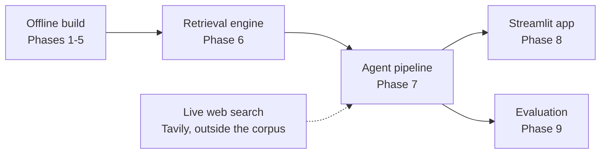
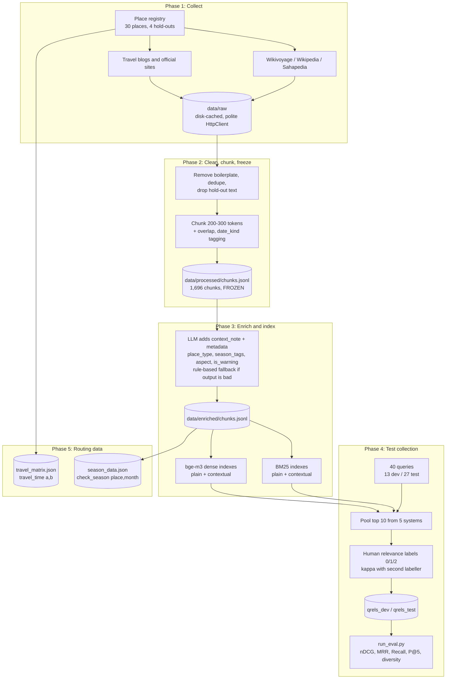
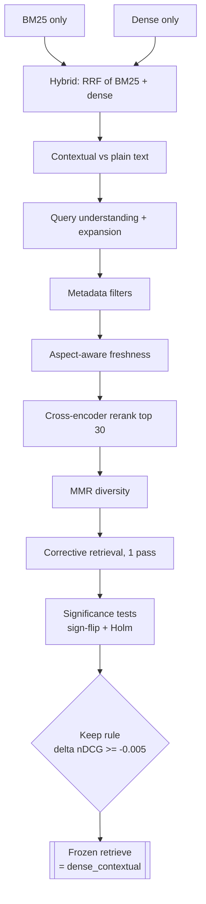
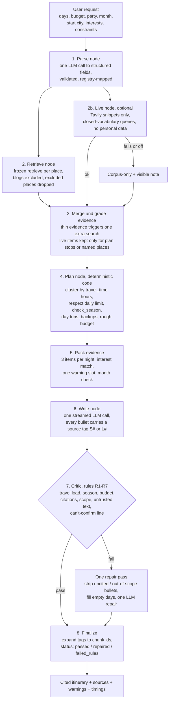
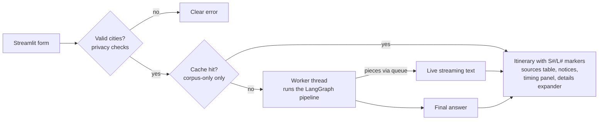
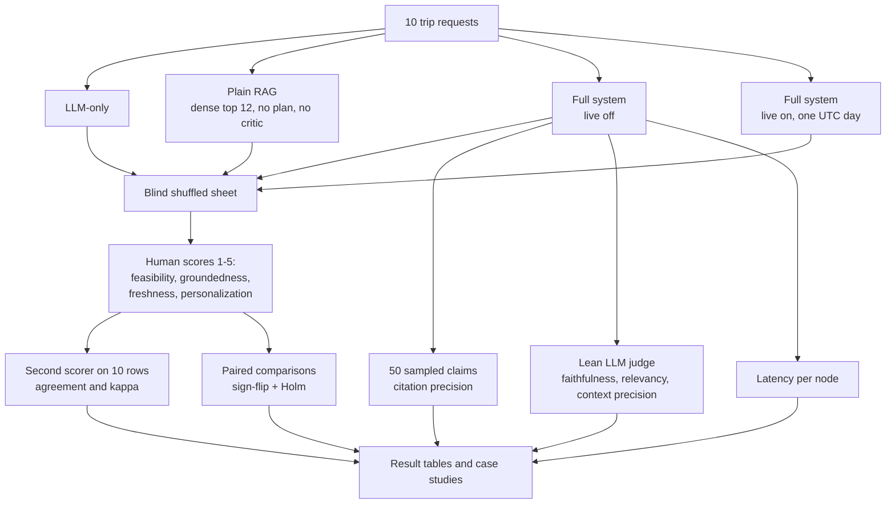
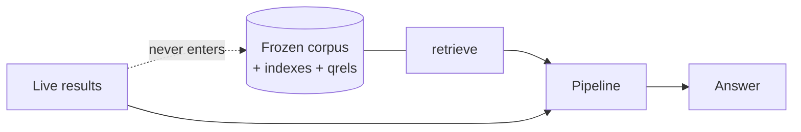

# South India Intelligent Travel Planner: Project Flow

An Information Retrieval project (agentic RAG). A traveller's preferences go in; a cited, feasible day-by-day South India itinerary comes out. The retrieval layer over a frozen corpus is what we measure; itinerary generation and the live web layer are the application on top.

Diagrams are Mermaid. They render on GitHub and in the VS Code Markdown preview (with a Mermaid extension).

---

## 1. Big picture

| Phases | Owner | What happens |
|---|---|---|
| 1-5 | Nivithasri | Collect data, clean and freeze corpus, enrich and index, build test collection, build routing data |
| 6-9 | Valincia | Retrieval ablations, place cards and agent pipeline, app, system evaluation |

---

## 2. Offline build (Phases 1 to 5)

**Key rule:** after the freeze, `data/processed/` never changes, so every metric stays reproducible.

---

## 3. Retrieval engine and ablations (Phase 6)

Each component was added one at a time and scored on **dev**; the **test** split ran once at the end.

Result: contextual notes helped; hybrid, expansion, filters and freshness did not beat plain dense search on dev, so `retrieve()` is frozen as **dense search over the contextual text**. The full chain is kept behind `RetrieveConfig` as a measured, non-frozen option.

---

## 4. Online pipeline (Phase 7): one request, end to end

What is code and what is LLM:

| Step | Who does it |
|---|---|
| Parse | LLM (cached) |
| Retrieve, grade, plan, pack, critic | Deterministic code |
| Route, season and budget lines | Code, tagged with tool provenance |
| Day-by-day wording | LLM (streamed), restricted to cited sources |

---

## 5. App (Phase 8)

Live-on answers are never written to disk. A "terms not verified, owner accepted risk" notice appears whenever the live step ran.

---

## 6. Evaluation (Phase 9)

Headline findings (details in `docs/decisions.md`, D130):

- Full system and plain RAG are far more grounded than LLM-only (by construction: LLM-only has no sources).
- The full system does **not** beat the baselines on feasibility or personalization.
- Live search scored **lower** than corpus-only on groundedness and freshness in this implementation (causes listed in D130).

---

## 7. Boundaries that protect the evaluation

- `retrieve()` uses the frozen corpus only; live chunks are never added to the corpus, indexes, qrels or ablations.
- Dev queries tune; test queries are only reported.
- Generator and judge models differ.
- Scope is South India only (TN, KL, KA, AP, TS, PY). Hold-out places are never collected or recommended.
- Every LLM call, download, embedding and search goes through the disk cache.

---

## 8. Repository map

| Path | Contents |
|---|---|
| `data/raw`, `data/processed`, `data/enriched` | Raw downloads, frozen chunks, enriched chunks |
| `index/` | BM25 and dense indexes, travel matrix, season data, place cards |
| `src/collect`, `src/process` | Collectors, cleaning, chunking, enrichment |
| `src/retrieval` | `retrieve()`, fusion, filters, freshness, rerank, MMR, grader |
| `src/agents` | LangGraph nodes: parse, retrieve, plan, write, critic |
| `src/tools` | `travel_time`, `check_season`, `get_place_card` |
| `src/live` | `live_retrieve()` (Tavily) |
| `eval/` | Queries, qrels, metrics, ablation outputs, Phase 9 results |
| `app/` | Streamlit page |
| `docs/` | plan, contracts, decisions, handoff |
